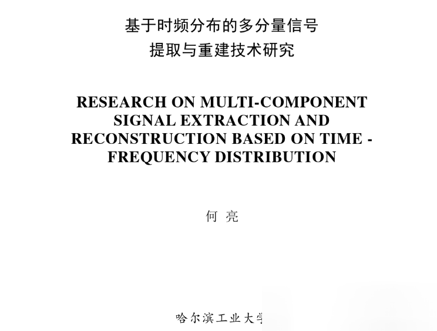
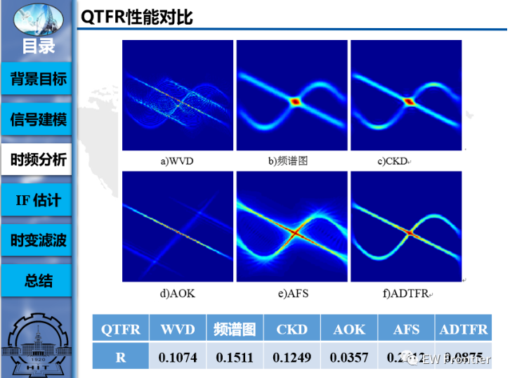
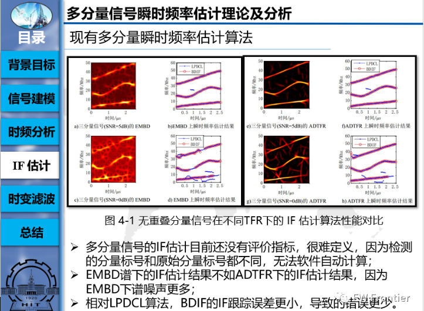
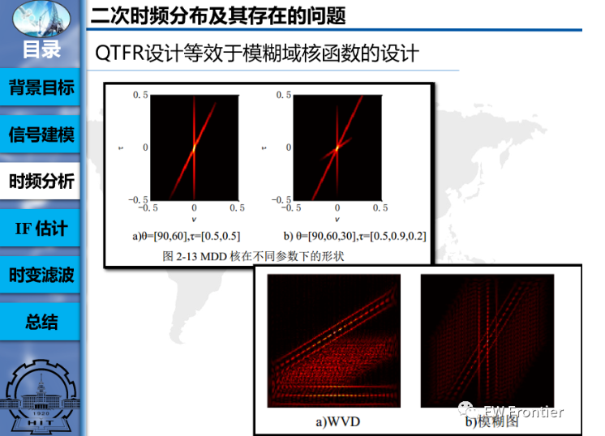
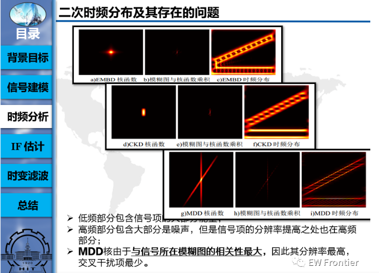

# Radar Signal Selection - Research on Multi-Component Signal Extraction and Reconstruction Based on Time-Frequency Distribution with MATLAB Codes Included

As the battlefield electromagnetic environment becomes increasingly complex, the radar signals intercepted in the battlefield become increasingly complex, not only with a variety of modulation types but also with an increasing number of components entering the receiver. Recognizing the types and parameters of each component from the complex intercepted signals is an important factor in formulating strategic decisions. To accurately analyze the multi-component radar signals and extract and reconstruct them is an inevitable process. This paper focuses on exploring the extraction and reconstruction techniques for multi-component signals based on their time-frequency distribution characteristics.
Firstly, common radar signal types are summarized, including their time-frequency and sparse features, and further research is conducted on the patterns present in the time-frequency distribution of multi-component radar signals. It was found that balancing between interference suppression and signal blurring during the calculation of time-frequency distribution is inevitable, hence the introduction of adaptive directional kernels in the second time-frequency distribution. This distribution achieves a relatively ideal balance between interference suppression and signal blurring by adaptively selecting blur domain directional kernels based on the characteristics of signal and interference items in the blur domain.
Then, to obtain the component structure of the signal, the instantaneous frequency estimation algorithm is studied. It was found that existing algorithms are not suitable for signals with intersecting components, thus a gradient rotation method is introduced to enhance the time-frequency distribution image. A segment connection and fitting algorithm based on endpoint gradients is proposed, which not only eliminates the errors in tracking the instantaneous frequencies of components but also reduces estimation errors.
Finally, based on the instantaneous frequency estimation, time-varying filtering methods are used to extract and reconstruct various component signals. Analysis shows that time-varying filters have significant distortion at the intersection points of components, hence an amplitude correction algorithm is introduced and a short-time fractional order Fourier transform time-varying filtering algorithm based on time-varying orders is proposed. The proposed algorithm significantly improves the accuracy of signal extraction and reconstruction, especially for the extraction and reconstruction of nonlinear frequency modulated signals.
The paper addresses the issue of cross-term interference and signal item ambiguity in multi-component signal time-frequency analysis, introducing an adaptive directional kernel time-frequency distribution algorithm to obtain a more ideal time-frequency distribution image. On this image, rotational gradient enhancement and instantaneous frequency connection fitting algorithms are further applied to extract the instantaneous frequencies of each component. Finally, a time-varying filtering algorithm based on time-varying order short-time fractional Fourier transform is employed to extract and reconstruct the time-domain waveforms of each component. The extraction and reconstruction of signals are decomposed into four steps: signal modeling, time-frequency analysis, instantaneous frequency extraction, and time-varying filtering, forming a comprehensive and effective scheme for the extraction and reconstruction of multi-component radar signals.
Keywords: Time-frequency analysis; Signal separation; Time-varying filtering; Short-time fractional Fourier transform; Instantaneous frequency
\n        \n      \n        \n  
\n        \n      \n        \n      c  

## Images

<!-- PAYMENT_BLOCK -->

## Get this dataset

- Payment link (Stripe): [Buy now](https://buy.stripe.com/3cs8yP7sY87d0vu9AB)
- Payment QR code: 

<!-- /PAYMENT_BLOCK -->
